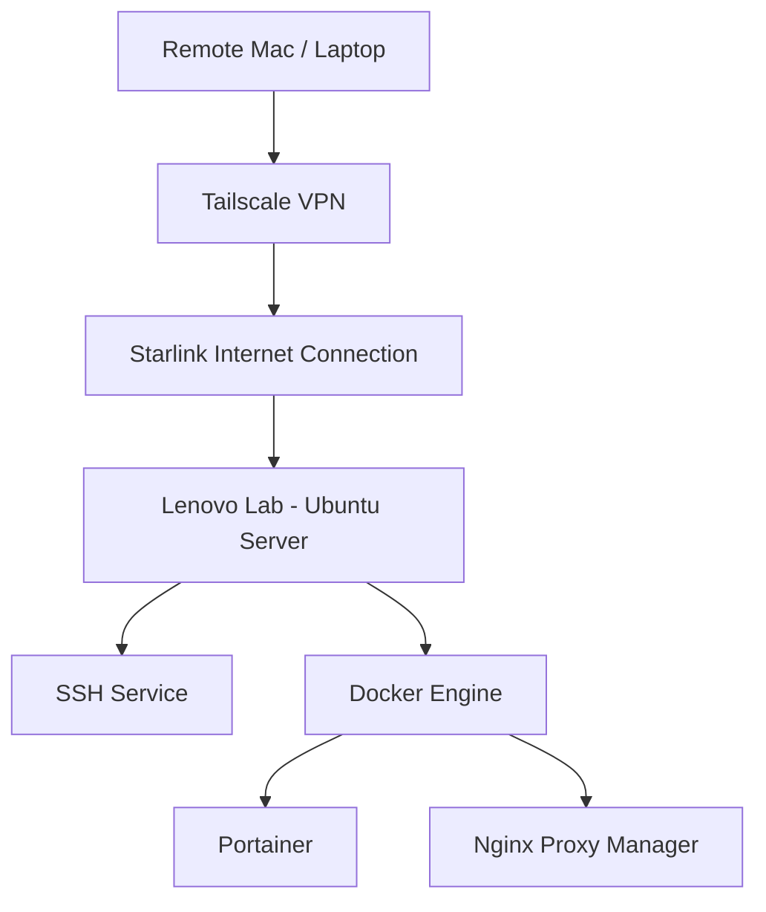

# Lenovo Ubuntu Homelab - Infrastructure Architecture

## Overview

This project uses repurposed Lenovo hardware running Ubuntu Server to host containerized infrastructure services and provide secure remote administration through Tailscale VPN.

## Network Architecture

## Infrastructure Components

| Component | Purpose |
| --- | --- |
| Lenovo hardware | Physical server |
| Ubuntu Server | Linux operating system |
| Starlink | Internet connectivity |
| Tailscale | Encrypted remote network access |
| SSH | Remote terminal administration |
| Docker | Container runtime |
| Portainer | Container management |
| Nginx Proxy Manager | Reverse proxy management |

## Remote Access Validation

Successfully established remote SSH access to the Lenovo Lab server from a separate physical location using Tailscale VPN. This confirmed the ability to administer the server outside the local network.

## Security Considerations

- Use authenticated Tailscale devices for remote access.
- Protect SSH credentials and private keys.
- Avoid exposing management interfaces directly to the public internet.
- Never commit credentials, authentication tokens, or private network configuration to GitHub.

## Future Improvements

- Add automated backups.
- Implement monitoring and alerting.
- Document container deployment procedures.
- Expand infrastructure automation.
